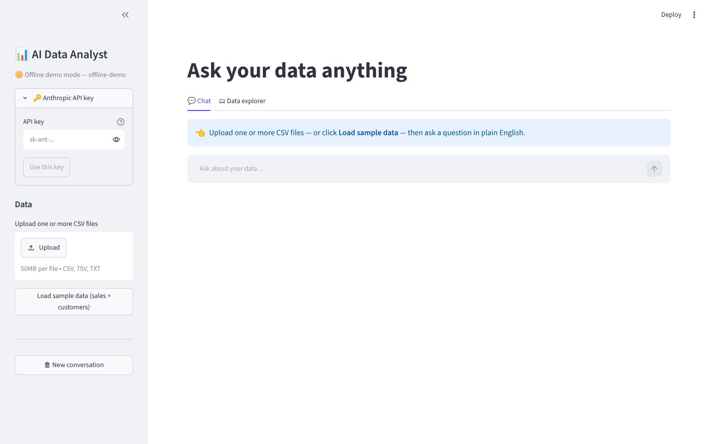
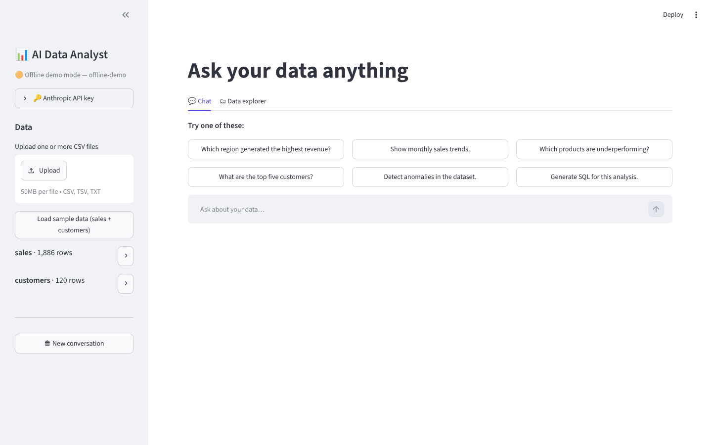
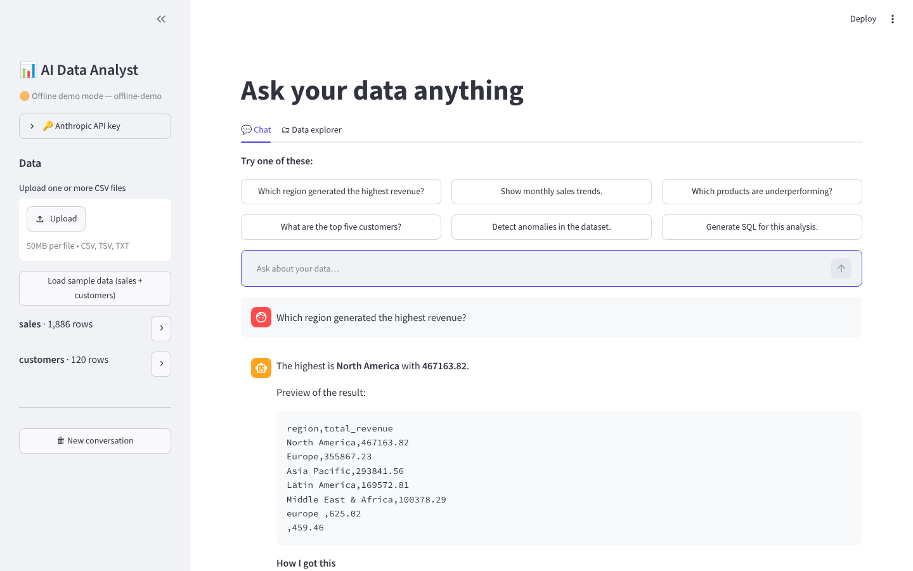
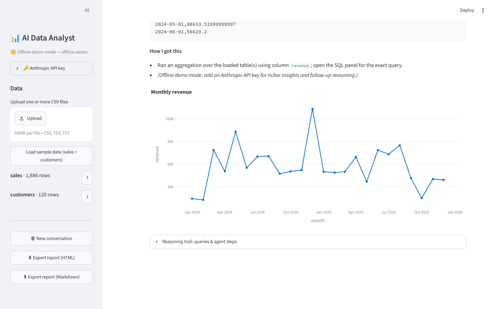
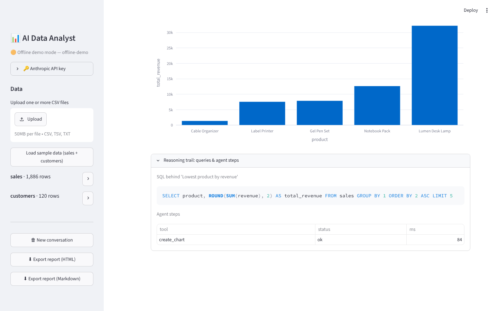
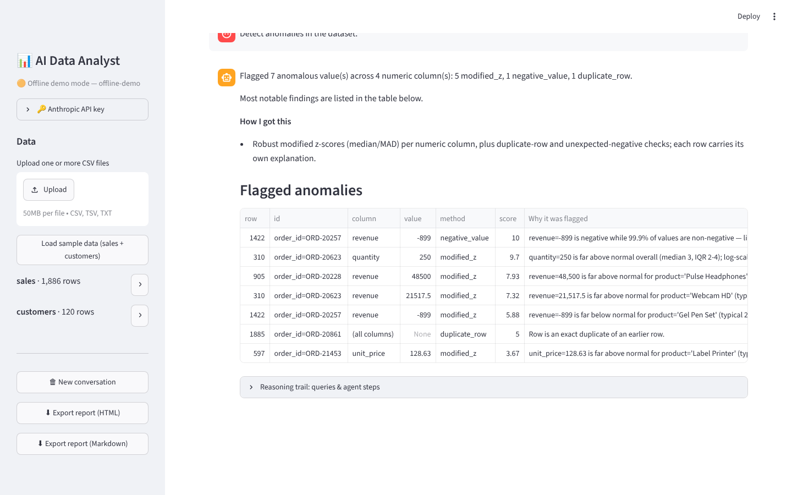
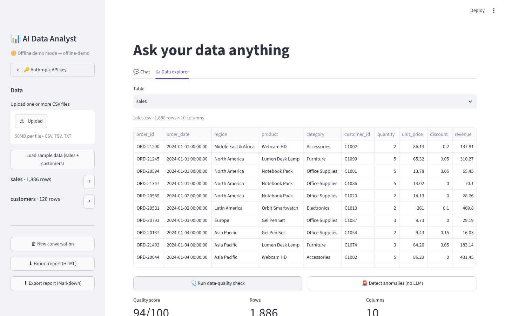
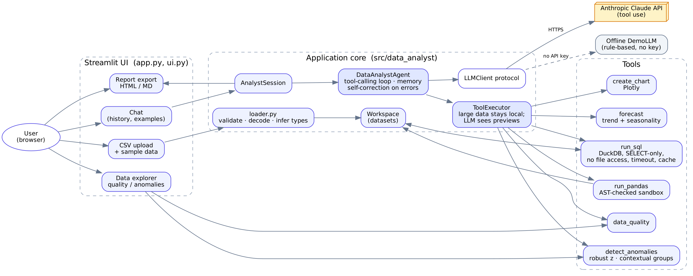

# 📊 AI Data Analyst

Upload one or more CSV files and **talk to your data in plain English**. The app answers questions, writes and runs SQL/Pandas, draws charts, flags and explains anomalies, forecasts, checks data quality, and shows the reasoning behind every answer — while remembering the conversation.

> Built for the *AI Engineer Assignment* (Digital Back Office Ltd.). Stack: **Python · Streamlit · Claude (tool use) · DuckDB · Pandas · Plotly · Docker**.

## Demo

🎬 **Demo video (29 s):** [`docs/demo.mp4`](docs/demo.mp4)

| | |
|---|---|
|  **Home** |  **Multi-file upload / sample data** |
|  **Question → answer + "How I got this"** |  **Monthly trend chart** |
|  **Reasoning trail: SQL + agent steps** |  **Anomalies with explanations** |
|  **Data-quality report** | |

> The screenshots/video were recorded in **offline demo mode** (no API key). With a key, Claude plans the analysis itself and writes richer insights.

## Features

| Requirement | Implementation |
|---|---|
| Upload & validate multiple CSVs | `loader.py`: size/extension/empty checks, encoding + delimiter detection, duplicate/blank column handling, numeric & date type inference, per-file warnings |
| Natural-language Q&A | Claude tool-calling agent (`agent.py`) that must get every number from a tool |
| Insights & summaries | System prompt enforces: direct answer → insights → **How I got this** |
| Charts | bar, line, area, pie, scatter, histogram, box, heatmap (Plotly) |
| SQL / Pandas | `run_sql` (DuckDB) and `run_pandas` (AST-checked sandbox); code is always shown to the user |
| Anomaly detection + why | Robust (median/MAD) z-scores, **contextual** baselines (e.g. `unit_price` judged within each `product`), unexpected negatives, duplicate rows — every flag carries a human-readable reason |
| Explain reasoning | "How I got this" section + collapsible *Reasoning trail* (SQL/Python, tool steps, timings, token use) |
| Conversation context | Full message history incl. tool results is replayed each turn (windowed, always starting on a user turn) so follow-ups like *"now by month"* work |
| **Bonus** | multi-file joins · data-quality checks · forecasting (trend + seasonality, 95 % band) · agentic tool loop with **self-correction on tool errors** · query caching · optional password auth · HTML/Markdown report export · structured logging · offline demo mode · CI · Docker |

## Architecture



Key idea: **data never flows through the LLM.** Tools execute locally and return a *small preview* (≤15 rows) to the model; the *full* result is attached to the UI as artifacts (tables, charts, SQL). This keeps prompts small and cheap, avoids leaking whole datasets to the API, and prevents the model from "eyeballing" numbers.

```
src/data_analyst/
  loader.py          CSV validation & normalisation        sql_engine.py   read-only DuckDB, timeout, cache
  workspace.py       datasets of one session               pandas_sandbox.py  AST-validated pandas execution
  agent.py           tool loop + memory + error recovery   anomaly.py / quality.py / forecast.py / charts.py
  tools.py           tool schemas + executor               llm.py          Anthropic client (+ error mapping)
  demo_llm.py        offline rule-based planner            report.py       HTML / Markdown export
  session.py         workspace + agent + turns             ui.py           Streamlit rendering of artifacts
app.py               Streamlit entry point
```

## Quick start

### Option A — Docker (recommended)
```bash
cp .env.example .env            # optionally add ANTHROPIC_API_KEY
docker compose up --build
# open http://localhost:8501
```
Or: `docker build -t ai-analyst . && docker run -p 8501:8501 --env-file .env ai-analyst`

### Option B — local
```bash
python -m venv .venv && source .venv/bin/activate
pip install -r requirements.txt
export ANTHROPIC_API_KEY=sk-ant-...      # optional
streamlit run app.py
```
Then click **Load sample data** (or upload your own CSVs) and ask away. You can also paste an API key in the sidebar.

**No API key?** The app starts in **offline demo mode**: a small rule-based planner drives the *same* tools so you can try the whole pipeline. It only understands simple questions (rankings, trends, top-N, anomalies, quality, forecast, "show the SQL"). Use a key for open-ended analysis.

### Configuration (env vars)
| Var | Default | Meaning |
|---|---|---|
| `ANTHROPIC_API_KEY` | – | enables the live model |
| `ANALYST_MODEL` | `claude-sonnet-5-5` | any tool-use capable Claude model |
| `ANALYST_MAX_UPLOAD_MB` | 50 | per-file limit |
| `ANALYST_MAX_TOOL_ITERATIONS` | 8 | agent step limit per question |
| `APP_PASSWORD` | – | if set, a password gate is shown |
| `LOG_LEVEL` | INFO | logging verbosity |

## Sample data
`data/sales.csv` (≈1.9 k orders, 2024–25) and `data/customers.csv` (120 rows), generated by `scripts/generate_sample_data.py` (seeded). They contain **planted problems** so anomaly/quality features have something to find: a 48 500 revenue typo, a 250-unit bulk order, a negative (refund) revenue, an exact duplicate row, missing regions/customer ids, and an inconsistent spelling (`"europe "`). Two products are deliberate under-performers.

Try: *Which region generated the highest revenue? · Show monthly sales trends · Which products are underperforming? · What are the top five customers? · Generate SQL for this analysis · Detect anomalies in the dataset · Forecast revenue for the next 6 months · How is data quality?*

## Safety & error handling
- **SQL**: parsed by DuckDB; exactly one `SELECT` allowed (no DDL/DML/`COPY`/`ATTACH`/`PRAGMA`), external file & network access disabled and config locked, 20 s timeout, row cap.
- **Pandas**: AST allow-checks (no imports, dunder access, file I/O, `eval/exec/getattr`…), whitelisted builtins, timeout, operates on copies. *This is defence-in-depth for a demo, not a hardened sandbox — run it in an isolated container/process for untrusted multi-tenant use.*
- Tool failures are returned to the model as `is_error` results so it can fix its query and retry; chat never crashes on a tool bug.
- LLM failures (bad key, rate limit, network) are mapped to friendly messages; history is rolled back so the conversation stays valid.
- Uploads: extension, size, emptiness, encoding, delimiter, parse errors and all-empty files are handled with clear messages.

## Testing
```bash
pip install -r requirements-dev.txt
pytest -q          # 60 tests, no network needed
```
Covers loader edge cases, SQL/pandas safety (incl. blocked file reads and timeouts), anomaly detection against planted outliers, quality, all chart types, forecasting, the agent loop with a scripted fake LLM (tool errors, memory, rollback, step limit, history window) and report export. CI: `.github/workflows/ci.yml`.

## Assumptions & implementation notes
- "Revenue", "sales" etc. are resolved from column names; the model states assumptions in *How I got this*.
- Column names are normalised to `snake_case`; table names come from file names (`Sales 2025.csv` → `sales_2025`).
- Datasets live in memory per browser session (no persistence); large files are bounded by the upload limit.
- Forecasts are deliberately simple and transparent (linear trend + month-of-year seasonality when ≥24 months). Treat them as indicative.
- Anomaly detection is statistical and explainable rather than a black-box model; thresholds (`|z| > 3.5`) are configurable in code.
- **The live Anthropic path is covered by unit tests with fakes, but I could not exercise it against the real API in the build environment (no key).** Run one question with your key before demoing.
- Not implemented (ideas): streaming responses, semantic search over text columns, persistent storage, multi-user auth beyond a shared password.
